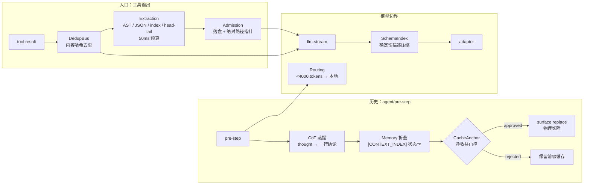

# dsh-context-manager (CostKillerOrchestrator)

DSH 插件：面向长上下文 / 多轮次 / 多工具 Agent 的**缓存对齐上下文治理系统**。
目标是在不降智的前提下，把工具输出、历史轨迹、工具 Schema 三类 Token 开销同时压下来，并用
CacheAnchor 守住前缀缓存的物理护盾。

## 架构



## 模块

| 模块 | 职责 | 关键机制 |
|---|---|---|
| `dedup-bus` | 重复工具输出 | SHA-256 精确哈希，第二次起只留指针 |
| `extraction` | 结构感知提纯 | AST 骨架 / JSON 压缩 / index-first / head-tail；Fail-Closed |
| `admission` | 超大输出落盘 | 收据 + 真实路径 + sha256，指针可回读 |
| `memory` | 历史折叠 | CoT 蒸馏 + `[CONTEXT_INDEX]` 任务状态卡 + 约束回填 |
| `cacheAnchor` | 缓存净收益门控 | `coldReadPenalty = cachedTokens × (30−1)`，负收益直接拒绝 |
| `schema-index` | 工具 Schema 瘦身 | 只截断 description，参数结构与工具集不变（缓存安全） |
| `routing` | 本地/云端分流 | <4000 tokens 且无跨文件依赖 → 本地 Ollama；5s 超时降级 |
| `breaker` | 压缩熔断 | 连续 3 次失败/零收益 → open，半开试探 |
| `spill-gc` | 落盘治理 | TTL 24h + 上限 50 + pin 指针文件 |

## 实测数据（`npm run demo`，合成负载）

| 场景 | 前 | 后 | 降幅 |
|---|---:|---:|---:|
| 121k 字符代码+JSON 工具输出 | 30,332 tokens | 3,176 tokens | 89.5% |
| 80 个冗长工具 Schema | 20,296 tokens | 10,638 tokens | 47.6% |
| 200 条路径清单 | 1,274 tokens | 209 tokens | 83.6% |
| 重复输出（第二次） | 502 tokens | 16 tokens | 96.8% |
| 21 条历史（含 10 段 CoT） | 5,544 tokens | 176 tokens | 96.8% |
| 二次折叠（prefixBreak） | 收益 2,023 vs 冷读 63,510 | 拒绝 | 护住缓存 |

> 数据来自仓库内 `demo.ts` 的合成负载，属于上界；真实长会话的保守区间约 **35%–55%**，
> 取决于工具输出结构、MCP 工具数量与压缩触发频率。

## 节省面板

插件运行时会持续写入两份面板文件（相对 DSH 进程工作目录，通常是 profile 目录）：

- `savings.md` —— 人类可读的 Markdown 面板（总量 / 分模块 / 最近事件）
- `savings.json` —— 机器可读快照

也可以在对话里让 Agent 调用工具 `costkiller_status`，返回同一份数据（含
`savedByAdmission / savedByExtraction / savedByDedup / savedByFold / savedBySchema`
与 `savingsFile` 路径）。

### 面板消费契约（重要）

- `savings.json` 是**快照**，不是增量流。消费方每次必须**替换**显示值，禁止把多次读取累加。
- 用 `ledgerId` 识别账本：插件每次 apply 会生成新 id；id 变化表示计数已重置。
- 用 `revision` 去重同一账本的重复写盘。
- `totalSavedTokens` 是「prompt 中少发的 token 数」，不是账单；
  `estimatedCostTokens` 是缓存感知的估算（schema 按命中价 1/30，工具输出按未命中价 1）；
  `contextReduction`（fold）是一次性上下文缩减，单独展示。
- **按工作区分账**：`byWorkspace[workspaceId]` 给出每个工作区的同类统计
  （`workspace` 路径、`label`、各模块、`events`、`tokensBeforeTotal/AfterTotal`）。
  `workspaceId` 是规范化绝对路径的稳定短 hash；顶层字段等于各工作区之和。
  工作区从 `ctx.sessions.get(id)?.header?.cwd`（取不到时 `list()` 兜底）解析，
  不使用 `process.cwd()`。
- **每维压缩率**：`byModuleBefore[module]` 是同一口径下的原始 token；
  消费方用 `byModule[module] / byModuleBefore[module]` 得到该维比例
  （`fold` 也可算，缺省显示 `-`）。
- **比例分母**：`tokensBeforeTotal / tokensAfterTotal` 是每次请求 prompt token 的累计
  （压缩前/后），消费方用 `1 - after/before` 算比例；当前只覆盖 schema 维度，
  因此带 `tokensBeforeTotalEstimated: true`。

## 安装

```powershell
dsh install D:\path\to\dsh-context-manager
```

或在 DSH profile 的 `package.json` 中加入 `file:` 依赖并把 `cost-killer-orchestrator`
放进 `dsh.profile.bundles`，然后 `pnpm install` 并重启 DSH。

## 配置（cordis.patch.yml）

```yaml
- insert:
    - id: dsh-context-manager
      name: dsh-context-manager
      config:
        maxInputTokens: 100000
        foldAtRatio: 0.6
        retainRecent: 8
        admissionTokens: 800
        extractionTokens: 500
        firewallTokens: 250
        assumedTurns: 40
        rewriteEnabled: false          # 有损；会让已发前缀失效（见 docs/REAL-BILL-ANALYSIS.md）
        rewriteRetainRecent: 8
        responseCacheEnabled: true     # 精确请求缓存（逐字节相同才重放）
        toolAttentionEnabled: false    # 动态工具集会作废整段 provider 缓存
        toolAttentionTopK: 5
        semanticCacheEnabled: false    # 语义复用会让「同一句话的第二轮」重放旧回答
        semanticCacheThreshold: 0.85
        keepaliveEnabled: true         # 缓存过期前重放前缀续命（TTL 默认 240s，最多 4 次）
        keepaliveTtlMs: 240000
        keepaliveRefreshes: 4
        keepaliveMinPromptTokens: 8000
        outputGuardEnabled: false       # 会砍掉正常回答（首个代码块/JSON 闭合即停），默认关
        localBaseUrl: http://127.0.0.1:11434
        compressionBudgetMs: 50
        localRouting: false
        spillMaxFiles: 50
        spillTtlHours: 24
```

## 验证

```powershell
npm run build     # tsc
npm run test      # CacheAnchor 公式 / AST / Fail-Closed
npm run verify    # 16 项宿主形态验收断言
npm run demo      # 端到端压缩、缓存门控、路由、GC、去重
```

## 设计红线

1. `CacheAnchor` 前缀对齐与净收益拦截不可绕过；
2. 任何可能丢核心约束的压缩必须 Fail-Closed 回退原文；
3. 无 `console.log`，所有决策写 `./debug.log`（JSON Lines，5MB 轮转）。

## License

MIT
